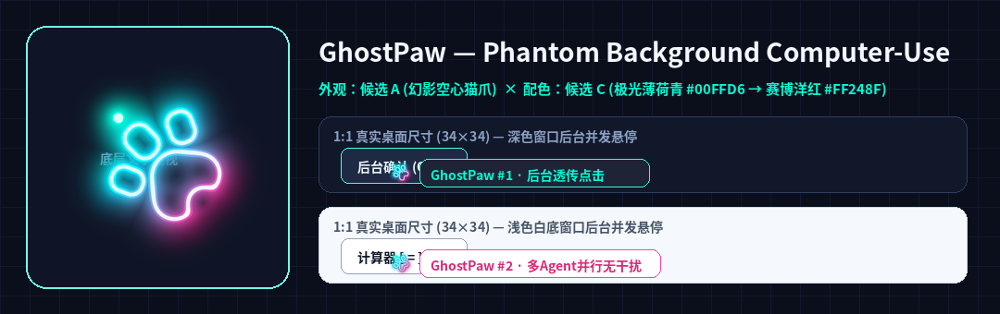

# 🐾 GhostPaw — 面向多智能体框架的零抢焦点后台桌面操控引擎

<p align="center">
  <strong>简体中文</strong> | <a href="README_EN.md">English</a>
</p>

<p align="center">
  
</p>

<p align="center">
  <b>后台无感唤醒窗口 · 被遮挡窗口穿透点击/输入/截图 · 多子智能体同屏并发霓虹镂空猫爪光标 · Phantom X-Ray 后台实时透视镜</b><br/>
  <sub>原生支持 <b>DeepSeek Harness (dsh)</b> · <b>Claude Code</b> · <b>OpenAI Codex</b> · <b>Google Antigravity</b> · <b>Cursor</b> · <b>Windsurf</b></sub>
</p>

---

## ✨ 为什么选择 GhostPaw？

传统的 `computer-use` 桌面自动化工具会强行接管你的物理鼠标，并把目标窗口置顶抢走输入焦点——导致 AI 干活时你根本没法正常使用电脑，更无法让多个子 Agent 同时并发操作不同的桌面软件。

**GhostPaw** 从操作系统窗口管理器与无障碍底层彻底解决了这一痛点（同时支持 **Windows** 与 **macOS**）：

1. **🔇 100% 零抢焦点后台启动与唤醒（`launch_background`）**：
   - **Windows**：通过 `ShowWindowAsync(SW_SHOWNOACTIVATE)` 与前台焦点护盾（Foreground Focus Shield）在后台静默启动或恢复最小化窗口，绝不抢夺你正在打字/点击的键盘鼠标焦点，也不改变前台窗口 Z 序。
   - **macOS (`darwin`)**：通过 `NSWorkspaceOpenConfiguration (activates = NO)` / `open -g` 在后台静默拉起或附着应用（针对 `TextEdit` 等无文档窗口应用还会自动通过后台无障碍菜单触发 `newDocument:` 并关闭干扰的文件选择框），全程保持 `isActive = 0`，不打断你的前台工作。
2. **👻 被遮挡窗口穿透点击、输入与无感截图（`GhostPawWin32BgV4` & `ghostpaw-macos-helper`）**：
   - **Windows**：直接向后台或被完全遮挡的窗口（`HWND` / `UIA`）投递左键单击、双击、右键、文本输入（`WM_CHAR` / `EM_REPLACESEL` / UIA `ValuePattern`）、快捷键（含 Windows 11 UWP 计算器 `CoreWindow` 零激活按键直投）与滚轮事件，并通过 DWM `PrintWindow(PW_RENDERFULLCONTENT)` 截取被遮挡窗口画面。
   - **macOS (`darwin`)**：内置免编译双架构 Universal（`arm64` + `x86_64`）原生引擎 `native/darwin-universal/ghostpaw-macos-helper`，支持窗口级 `AXUIElementPerformAction(kAXPressAction)`（含 macOS 计算器按钮 `AXIdentifier` 极速通路）、`AXUIElementSetAttributeValue(kAXValueAttribute)` 后台文本直写、`CGEventPostToPid` 进程级按键/滚轮透传，以及 `_AXUIElementGetWindow` $\rightarrow$ `screencapture -l <cgWindowId> -x -o` 后台单窗口无遮挡截图。
3. **🐾 多子智能体毫秒级同屏并发 & 霓虹镂空猫爪光标（Neon Hollow GhostPaw Cursor）**：
   - 主 Agent 与任意数量的子 Agent 可以在 **Windows** 和 **macOS** 上**同一毫秒并发操作不同的桌面窗口**，彼此零锁竞争（绕过全局 `interaction.lock`），也不干扰你的物理鼠标。
   - **独立视觉反馈 + 100% 鼠标穿透**：
     - **Windows**：每个子 Agent 拥有独立命名管道渲染器（`\\.\pipe\agent-desktop-cursor-...`）。
     - **macOS**：内置统一 60 FPS 多智能体合成守护进程（`GhostPawOverlayView` + `GPAgentOverlayState`，`NSApplicationActivationPolicyProhibited` + `NSScreenSaverWindowLevel` + `ignoresMouseEvents = YES`），同屏渲染多个子 Agent 的**专属配色霓虹镂空猫爪光标**（薄荷青 `#00FFD6`、赛博粉 `#FF248F`、琥珀金 `#FBBF24` 等，中心透明镂空不挡按钮文字）、点击扩散波纹与半透明毛玻璃状态气泡，并配备 **👻 Phantom X-Ray 后台窗口 12 FPS 实时透视镜**（即使你的终端全屏遮挡了后台应用，也能肉眼实时监看所有后台 Agent 的同步操作，空闲 10 秒后自动隐身）。

---

## 🚀 各大 Agent 框架一键接入指南

### 1. DeepSeek Harness (`dsh`)

#### 方式 A — 通过 DSH 去中心化插件市场安装（`market-index.json`）
将以下插件源地址添加到你的 DSH 插件市场配置中：
```text
https://raw.githubusercontent.com/ShabbyWhineYear/GhostPaw/main/market-index.json
```
随后在 DSH 中搜索 **`ghost-paw`** 一键安装即可。

#### 方式 B — 本地 Profile 配置接入（`cordis.patch.yml`）
安装至你的 DSH Profile（如 `~/.dsh/profiles/desktop`）并在 `cordis.patch.yml` 中启用：
```yaml
plugins:
  ghost-paw:
    enableSystemPrompt: true
    systemPromptOrder: 45
```

---

### 2. Claude Code (`claude`)

一行命令将 GhostPaw 注册为 MCP Server：
```bash
claude mcp add ghost-paw -- npx -y github:ShabbyWhineYear/GhostPaw mcp
```
*（也可以将 [`skills/ghost-paw/SKILL.md`](./skills/ghost-paw/SKILL.md) 复制到 `~/.claude/skills/ghost-paw/SKILL.md` 作为原生技能加载。）*

---

### 3. OpenAI Codex CLI / App (`codex`)

在 `~/.codex/config.toml` 中添加：
```toml
[mcp_servers.ghost_paw]
command = "npx"
args = ["-y", "github:ShabbyWhineYear/GhostPaw", "mcp"]
```

---

### 4. Google Antigravity (`agy`) / Cursor / Windsurf / Cline

在 `mcp_config.json`（或 `.cursor/mcp.json`）中添加：
```json
{
  "mcpServers": {
    "ghost-paw": {
      "command": "npx",
      "args": ["-y", "github:ShabbyWhineYear/GhostPaw", "mcp"]
    }
  }
}
```

> **macOS 权限提示**：首次在 macOS 上运行时，请确保你的宿主终端或 IDE 已在「**系统设置 → 隐私与安全性 → 辅助功能 (Accessibility)**」中开启授权（可通过运行 `npx ghost-paw permissions --request` 一键弹出系统授权引导）；若需开启 Phantom X-Ray 后台被遮挡窗口实时画面透视，请同时勾选「**屏幕录制 (Screen Recording)**」权限。

---

## 🛠️ 核心工具集（`agent_desktop` & `computer`）

### `agent_desktop`（语义无障碍树 + 坐标双模后台引擎）

| 动作 (`action`) | 功能说明 |
| :--- | :--- |
| `launch` | 在后台无感启动或附着目标应用（如 `app: "calc"`, `headed: false`），不抢焦点并返回 `window_id`（`w-<id>`）。 |
| `list_windows` | 列出当前桌面所有窗口的 `id`、`title`、`app`、`pid` 与像素边界 `bounds`。 |
| `snapshot` | 抓取目标 `windowId` 或 `app` 的无障碍语义树（`@s1:e1`, `@s1:e2`...）与控件精确坐标。 |
| `click` / `double_click` / `right_click` | 在后台穿透点击语义引用 `ref`（如 `"e5"`）或指定 `(x, y)` 坐标，并同步展示霓虹镂空猫爪光标与点击波纹。 |
| `set_value` / `type` / `clear` | 在不抢夺键盘焦点的前提下，向后台输入框或编辑器写入/清空文本。 |
| `press` | 向后台目标窗口直接投递快捷键或按键（如 `key: "ctrl+s"`, `"cmd+s"`, `"return"`, `"escape"`）。 |
| `scroll` | 在后台目标窗口内执行上下左右滚动（如 `direction: "down"`, `amount: 3`）。 |
| `screenshot` | 对后台或被遮挡的目标窗口进行无感单独截图（Windows DWM `PrintWindow` / macOS `CGWindowID`）。 |
| `batch` | 原子化连续执行多步后台交互，并保持平滑连贯的猫爪光标轨迹动画。 |

### 多子智能体同屏并发调用示例

当派遣多个子 Agent 同时操作不同桌面应用时，只需为每个子 Agent 传入各自独立的 `agentId` 与 `windowId`（或 `app`）：

```json
// 子智能体 #1（后台操作计算器 — 自动分配薄荷青 #00FFD6 猫爪光标）
{
  "action": "click",
  "windowId": "w-31552",
  "ref": "e18",
  "agentId": "subagent-calc",
  "cursorLabel": "subagent-calc · 点击 9",
  "headed": false
}
```

```json
// 子智能体 #2（同一毫秒后台操作记事本/文本编辑 — 自动分配赛博粉 #FF248F 猫爪光标）
{
  "action": "set_value",
  "windowId": "w-31555",
  "x": 680,
  "y": 340,
  "value": "双 Agent 后台并发写入，全程零焦点冲突！\n",
  "agentId": "subagent-textedit",
  "cursorLabel": "subagent-textedit · 同步写入",
  "headed": false
}
```

---

## 🙏 致谢与借鉴项目（Acknowledgements & Upstream Credits）

**GhostPaw** 站在巨人肩膀上构建，特此向以下提供底层架构、驱动协议与交互范式灵感的优秀开源项目致谢：

1. **[`vercel-labs/agent-desktop`](https://github.com/vercel-labs/agent-desktop)** *(Vercel Labs)*
   - **借鉴与复用部分**：跨平台操作系统无障碍树（`Windows UIA` / `macOS AXUIElement` / `Linux AT-SPI`）快照引擎（`@snapshot_id:eN` 语义引用）及原生分层透明窗口光标覆盖层 IPC 协议（`v1.2.0`）。
   - **GhostPaw 原创增强部分**：Windows 被遮挡窗口 Win32 消息穿透引擎（`GhostPawWin32BgV4`）、macOS 免编译 Universal 原生后台透传与多智能体统一 60 FPS 合成引擎（`ghostpaw-macos-helper` + Phantom X-Ray 12 FPS 后台窗口实时透视镜）、零激活后台应用启动焦点护盾（`launch_background`）、多子智能体并行光标通道隔离、Linux X11 32-bit ARGB 穿透覆盖层守护进程、Windows UAC/DACL 权限自愈，以及专属 **霓虹镂空猫爪光标（Neon Hollow GhostPaw Cursor）**。
2. **[`bytedance/UI-TARS-desktop`](https://github.com/bytedance/UI-TARS-desktop)** (`@ui-tars/operator-nut-js`) & **[`nut-tree-fork/libnut`](https://github.com/nut-tree-fork/libnut)**
   - **借鉴与复用部分**：原生 C++ N-API 桌面自动化扩展（`libnut.node`）、HiDPI 逻辑与物理像素坐标换算，以及绕过中文输入法候选框吞字问题的无损 Unicode 剪贴板注入方案。
3. **[`anthropics/anthropic-quickstarts` (`computer-use-demo`)](https://github.com/anthropics/anthropic-quickstarts/tree/main/computer-use-demo)** *(Anthropic)*
   - **借鉴与复用部分**：统一的 `computer` 工具动作 Schema（`screenshot`, `click`, `double_click`, `triple_click`, `right_click`, `drag`, `scroll`, `type`, `key`, `wait`）与多模态视觉动作闭环范式。
4. **[`simular-ai/Agent-S`](https://github.com/simular-ai/Agent-S)** *(Simular AI — Agent-S2)*
   - **借鉴与复用部分**：动作执行后的视觉定位辅助反馈——在截图中自动叠加像素坐标标尺网格（`Coordinate Grid`）与红色落点十字准星（`Red Crosshair`）。
5. **[`OpenInterpreter/open-interpreter`](https://github.com/OpenInterpreter/open-interpreter)** & **[`asweigart/pyautogui`](https://github.com/asweigart/pyautogui)**
   - **借鉴与复用部分**：物理鼠标紧急制动机制（Fail-Safe）——在 `headed: true` 前台模式下，只要用户将物理鼠标推至屏幕左上角 `(0, 0)` 或主动大幅移动鼠标（`>160px`），立即中止自动化并归还控制权。
6. **[`DeepSeek Harness (dsh)`](https://www.deepseek.com/harness/)** & **[`@deepseek-ai/cordis`](https://www.npmjs.com/package/@deepseek-ai/cordis)**
   - **借鉴与复用部分**：Cordis 依赖注入插件架构与去中心化 `MarketIndex`（Format 1）市场索引规范。

---

## 📄 开源协议（License）

[MIT](./LICENSE) © ShabbyWhineYear
